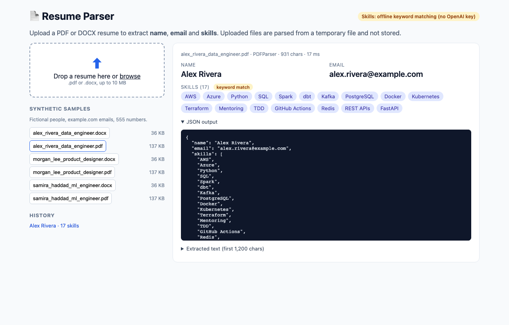
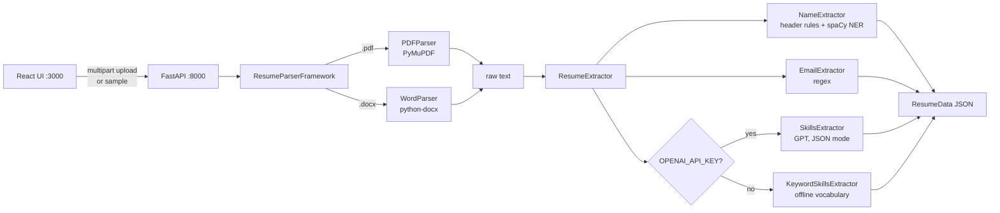
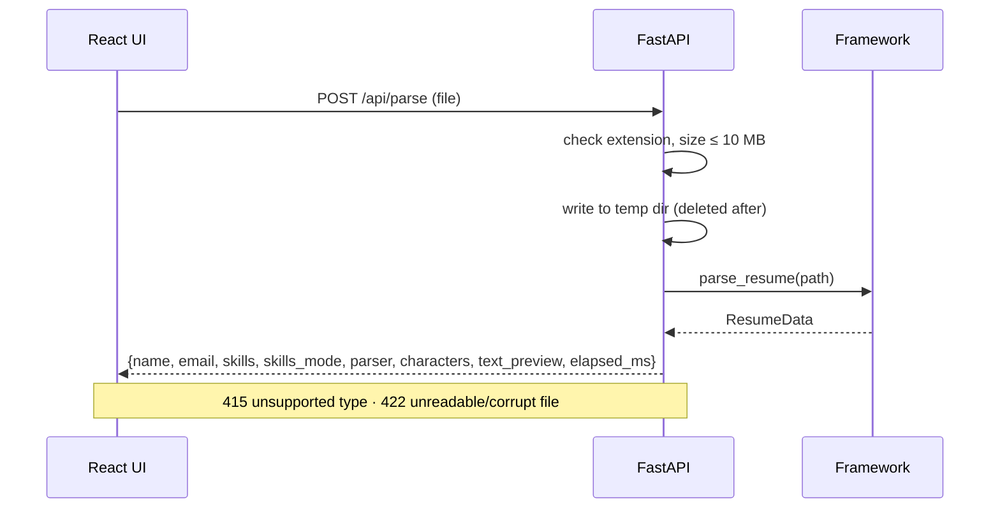
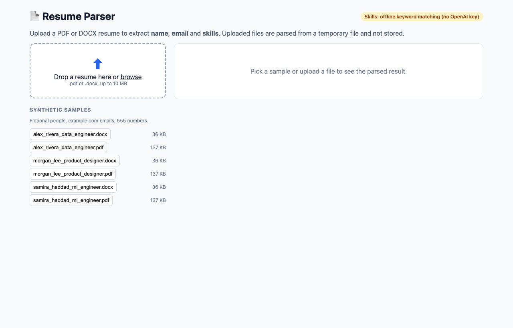
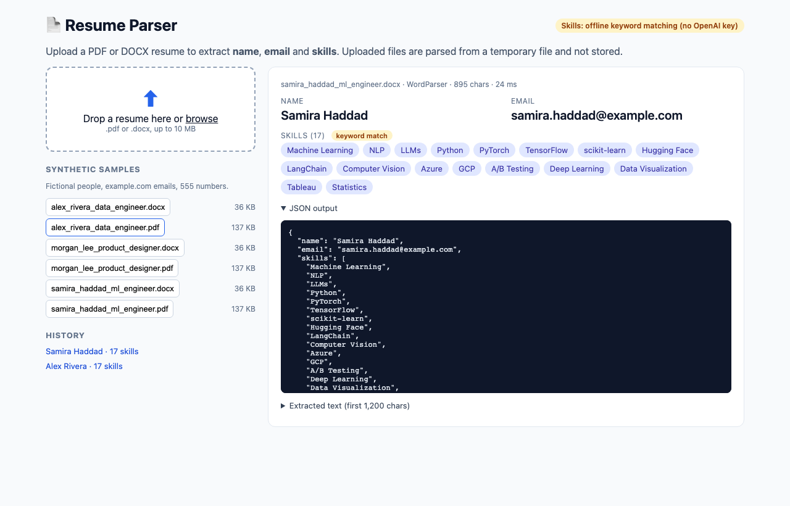
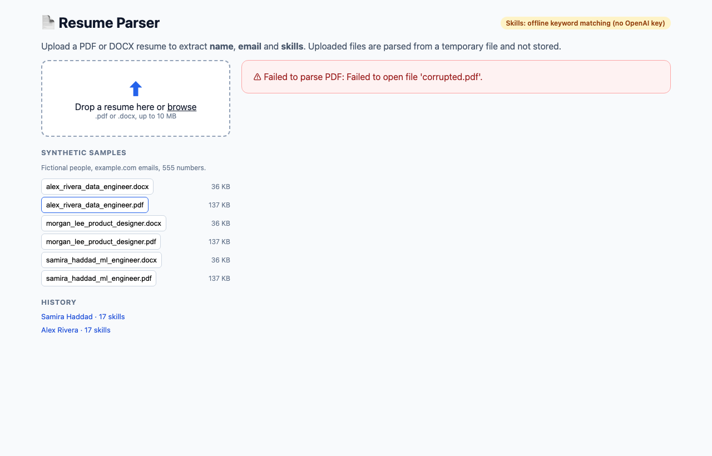
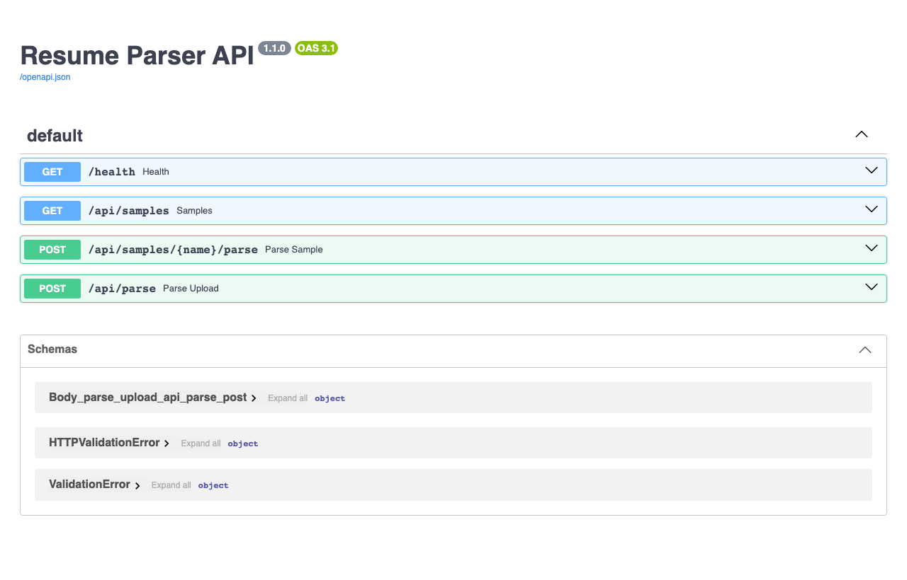

# 📄 Resume Parser

<p align="center"></p>

> Upload a PDF or Word resume and get back structured **name, email and skills** as JSON. A layered Python framework (PyMuPDF, python-docx, spaCy NER, GPT) is now wrapped in a **FastAPI service and a React upload UI** that start with a single `docker compose up`, **with or without an OpenAI key**.



---

## Business case

Recruiting teams still copy names, emails and skills from resumes into their systems by hand. This parser reads PDF and Word files and returns those fields as JSON, with each field extracted separately so one failure doesn't lose the rest. It extracts data and makes no hiring decision, which matters under laws such as New York City's Local Law 144. [docs/BUSINESS_CASE.md](docs/BUSINESS_CASE.md) covers the use cases, an illustrative ROI model and the privacy risks.

## 1. The problem

Resumes come in many layouts and two main file formats. Recruiting tools need the same three fields from every one of them, reliably, and should degrade gracefully when a file is odd or a service is down.

## 2. How it works

<p align="center"></p>



Each field has its own extractor (strategy pattern), and each extractor fails independently, so a broken skills call still returns name and email. Parsers are registered by file extension, so new formats plug in with `ResumeParserFramework.register_parser(".txt", MyParser)`.

### Request lifecycle



## 3. Run it

```bash
cp .env.example .env      # optional: add OPENAI_API_KEY for GPT skills
docker compose up --build
```

| URL | What |
|---|---|
| http://localhost:3000 | Upload-and-parse UI |
| http://localhost:8000/docs | API (OpenAPI) |

`docker compose down` stops it. The spaCy model `en_core_web_sm` is a pinned dependency now, so there is no manual download step.

### LLM vs offline mode, labelled everywhere

| | `OPENAI_API_KEY` set | not set |
|---|---|---|
| Skills | GPT (`OPENAI_MODEL`, JSON mode, retries) | `KeywordSkillsExtractor`: about 100 canonical skills plus aliases, word-boundary matching |
| API field | `"skills_mode": "llm"` | `"skills_mode": "keyword"` |
| UI badge | green *Skills: LLM (model)* | amber *offline keyword matching (no OpenAI key)* |

Before this change, the settings *required* a key, so even importing the package failed without one. The key is now optional.

> **The screenshots in this README were taken in offline keyword mode.** No OpenAI key was available while building this, so the GPT path was not exercised end to end here. Its unit tests use mocks, and its integration tests skip when no key is set.

## 4. What you see

**Home.** Drop zone, the synthetic samples, and the active skills mode:



**A real upload through the file picker** (DOCX):



**Corrupt file.** The API returns 422 and the UI shows why:



**API:**



Screenshots are real, captured headless from the running stack with `uv run --with playwright python scripts/screenshots.py`.

## 5. Sample data: synthetic only

`samples/` holds three **fictional** resumes (Alex Rivera, Samira Haddad, Morgan Lee), each as a PDF and a DOCX. They use invented employers marked *(fictional)*, `example.com` emails and 555 phone numbers, and are generated by `scripts/make_sample_resumes.py`. The UI, the API tests and the screenshots use only these files.

## 6. API

| Method | Path | Notes |
|---|---|---|
| GET | `/health` | status, `skills_mode`, `llm_enabled`, model, formats |
| GET | `/api/samples` | the synthetic sample files |
| POST | `/api/samples/{name}/parse` | parse one sample (path traversal blocked) |
| POST | `/api/parse` | multipart `file` (.pdf or .docx, up to 10 MB). Files are not stored |

```bash
curl -F file=@samples/alex_rivera_data_engineer.pdf http://localhost:8000/api/parse
```

## 7. CLI (unchanged, moved)

The original scripts now live in `scripts/`:

```bash
uv run python scripts/parse_and_log.py samples     # batch parse, CSV/JSON logs in outputs/
uv run python scripts/demo.py
uv run python scripts/check_openai.py
```

## 8. Tests and CI

```bash
uv sync --extra dev && uv run pytest -q    # 56 passed, 7 skipped without a key
```

The 7 skipped tests are the OpenAI integration tests, which run only when a real key is set. GitHub Actions runs the test suite and the frontend type-check and build, then `docker compose build`.

## 9. Layout

```
src/resume_parser/     framework, plus api.py (FastAPI) and extractors/keyword_skills_extractor.py
frontend/              React + Vite + TypeScript UI, served by nginx
samples/               synthetic resumes (PDF + DOCX)
scripts/               CLI scripts, sample generator, screenshot capture
tests/                 unit + integration tests (test_data/ is the original fixture set)
legacy/                moved, not deleted: requirements.txt (pyproject.toml + uv.lock are canonical)
docs/                  ORIGINAL_README.md (full framework manual), screenshots
```

The detailed framework manual (design patterns, troubleshooting, extending) is preserved in [docs/ORIGINAL_README.md](docs/ORIGINAL_README.md). Its CLI paths now live under `scripts/`.
